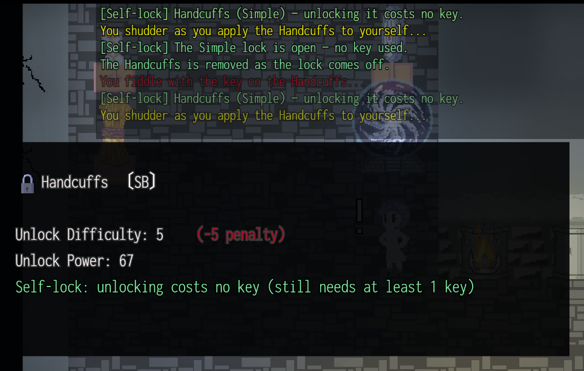
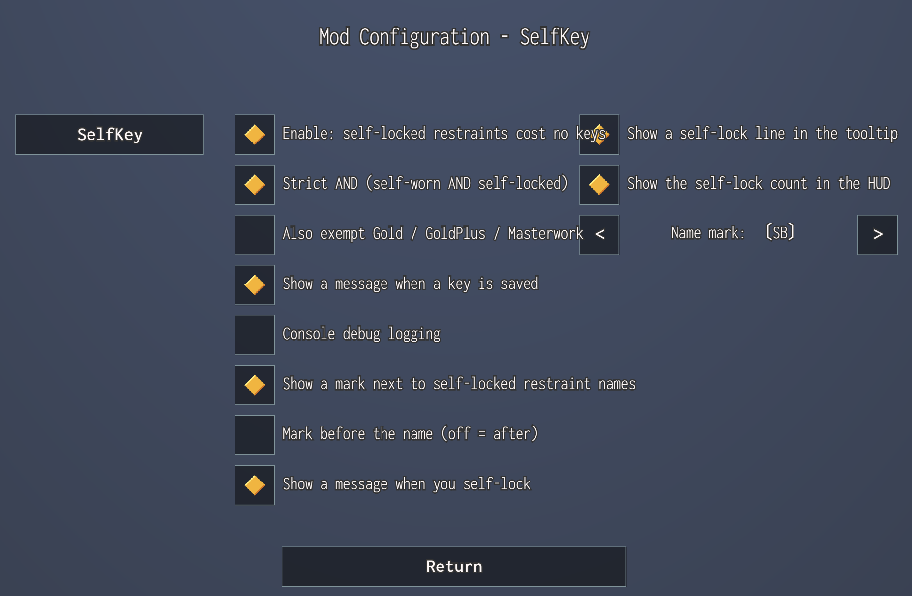

# SelfKey

[English](README.md) · [中文](README.zh-CN.md) · For KinkiestDungeon **5.5.12+**

**Now you can put restraints on yourself "safely":** restraints you wear and lock yourself cost no key / keycard when unlocked (but you need at least one key on you). Note: whether something counts as "self-locked" is a flag this mod sets — anything put on before the mod was installed doesn't count.

## What counts as "self-applied"

1. **You put it on yourself**: from the inventory, from the restraint screen, or a self-bondage spell that runs through the normal equip flow.
2. **The lock on it is one you applied**: a lock the item came with, or one you locked manually.

By default both have to hold (**strict AND**) — the restraint must be worn by you *and* locked by you. Turn that off and only the lock has to be yours.

These still cost a key as usual:

- Restraints put on you by enemies, traps or living restraints
- Locks swapped or upgraded by an enemy
- Doors and chests, always
- `Gold` / `GoldPlus` / `Masterwork`, not exempt by default (adjustable in the options)

`Cyber` locks still don't raise the security value when unlocked.

## In-game hints

- Exempt restraints get a mark on their name: `※` by default, or `〔SB〕`; it works in the inventory, tooltips, equipment slots and messages.
- The buff panel shows how many active self-locks you're wearing.
- Locking something on yourself, and saving a key on an unlock, each print a line in the message log — both can be turned off separately.

## Options

| Option | Default | Notes |
| --- | --- | --- |
| Enable: self-locked restraints cost no keys | On | Master switch |
| Strict AND (self-worn AND self-locked) | On | Off = only the lock has to be yours, so "enemy put it on, you locked it" is exempt too |
| Also exempt Gold / GoldPlus / Masterwork | Off | Not exempt by default, since it shifts the balance too much |
| Show a message when a key is saved | On | One line per free unlock |
| Console debug logging | Off | Prints lock decisions to the browser console |
| Show a mark next to self-locked restraint names | On | Display only, never affects the key check |
| Mark before the name (off = after) | On | `※ Handcuffs` instead of `Handcuffs ※` |
| Name mark | `※` | `※` or `〔SB〕` |
| Show a message when you self-lock | On | One line each time you lock something on yourself |
| Show a self-lock line in the tooltip | On | Greys out once the lock was swapped by an enemy |
| Show the self-lock count in the HUD | On | Reuses the vanilla restraint icon |
