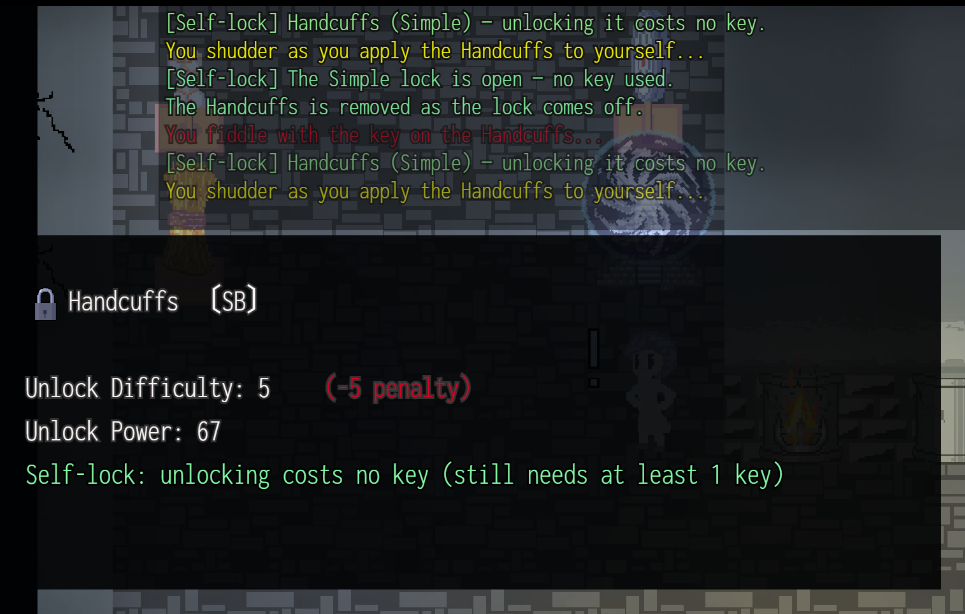
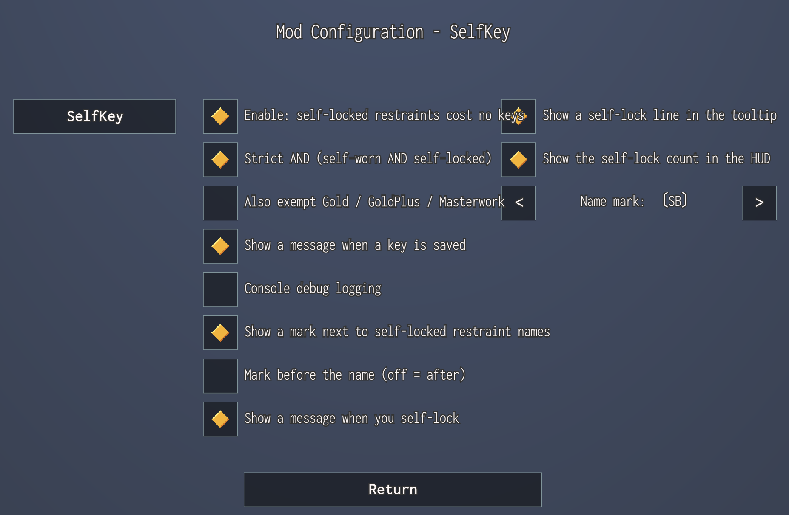

# 自缚钥匙 SelfKey

[English](README.md) · [中文](README.zh-CN.md) · 适用于 KinkiestDungeon **5.5.12+**

**自己穿、自己上锁的束缚具，解锁时不消耗钥匙 / 钥匙卡。** 前提是身上还得带着一把对应的钥匙 —— 钥匙留着，但不能没有。

原版里每次解锁都要吃掉一把钥匙。这个 Mod 只去掉「这把锁是我自己扣上去的」这一种情况的消耗，其它一概保持原版。

## 什么算「自缚」

两件事，都记在物品上：

1. **是你自己穿上的** —— 背包穿戴、束缚具界面，或者走正常装备流程的自缚法术；
2. **当前这把锁是你自己上的** —— 装备自带锁，或者你手动「上锁」。

默认要求两条同时满足（**严格 AND**）。关掉它以后只看第 2 条，这样「敌人给你穿、你自己锁」也算免。

照常扣钥匙的：

- 敌人、陷阱、活体束缚给你戴上的；
- 被敌人换锁 / 升级过的锁 —— 哪怕东西是你自己穿的，也会恢复收费，直到你重新自己上锁；
- 门和箱子，永远照常扣；
- `Gold` / `GoldPlus` / `Masterwork` 三类，默认不免（可以在配置里放开）。

`Cyber` 锁是彻底免的：不吞 KeyCard，也不涨安保值。

解锁难度、成功率、失败时可能掉一把钥匙，这些全都没动 —— 本 Mod 只决定「成功解锁时扣不扣」。

## 看得见的提示

- 当前确实免钥匙的束缚具，名字前面会多一个短角标：默认 `※`，也可以换成 `〔自缚〕`；背包、悬停、装备栏、消息里都生效。它只在真的免扣时才出现，不会骗人。
- 穿着束缚具时，悬停面板会多一行：*自缚锁：解锁不消耗钥匙（仍需至少 1 把）*。
- 状态栏会显示「当前身上有几件有效自缚锁」。
- 自己上锁时、以及某次解锁省下钥匙时，消息栏各提示一句。

四个提示都只是显示，可以分别关掉，不影响任何判定。

## 配置

`Options → Mod Configuration → 自缚钥匙`。默认值基本就够用，值得知道的是这三条：

| 选项 | 默认 | 说明 |
| --- | --- | --- |
| 启用：自缚锁免钥匙 | 开 | 总开关，关掉就回到原版消耗。 |
| 严格 AND（自缚穿戴 + 自锁都满足） | 开 | 关掉 = 只看锁是不是你上的。 |
| 特殊锁也免（Gold / GoldPlus / Masterwork） | 关 | 高档锁默认照常收费。 |

## 安装

1. 从 [Releases](../../releases) 下载 `SelfKey.zip`。
2. 独立版：把 zip 丢进 `<游戏目录>/Mods/`，启动游戏。网页版：先勾上 **Auto Load Mods**，再 `Options → Mods → Load Mod .zip`，然后刷新页面。
3. `Options → Mod Configuration → 自缚钥匙`。

## 一个坑

装 Mod 之前就已经穿在身上的束缚具没有标记，所以照样扣钥匙。脱下来重新自己穿一次就好。
